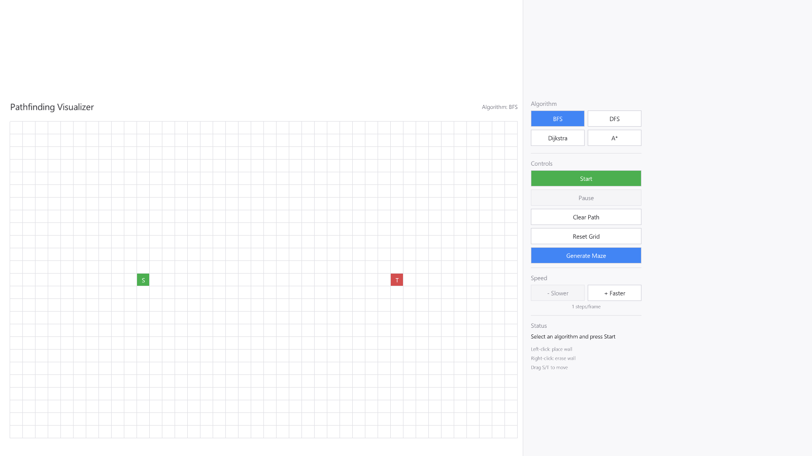
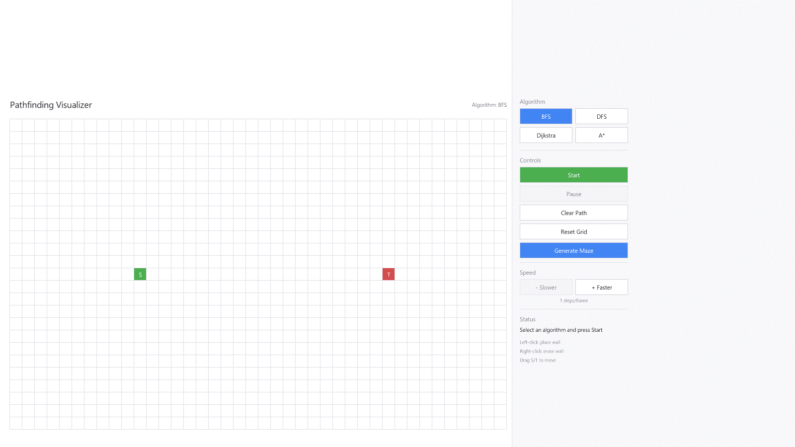
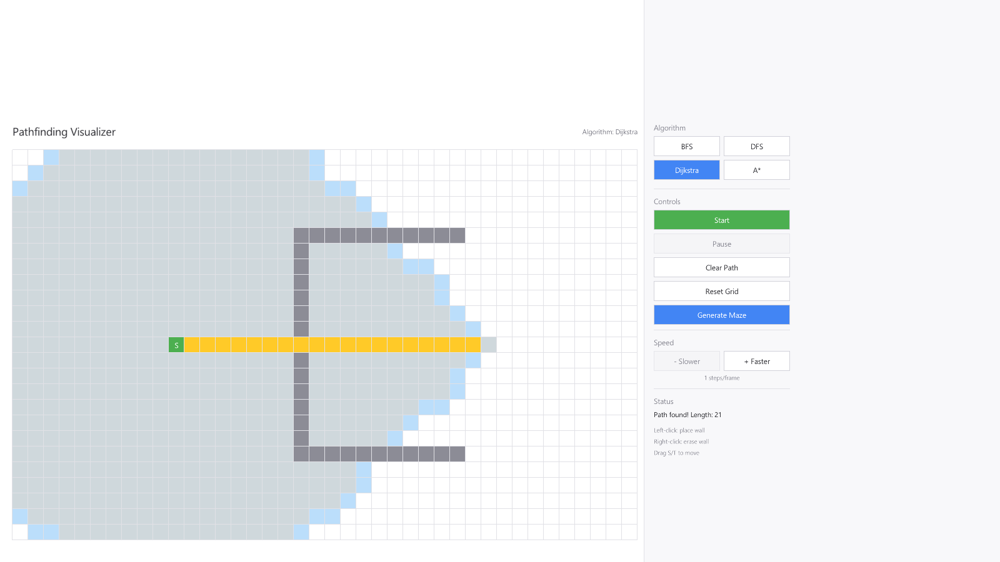
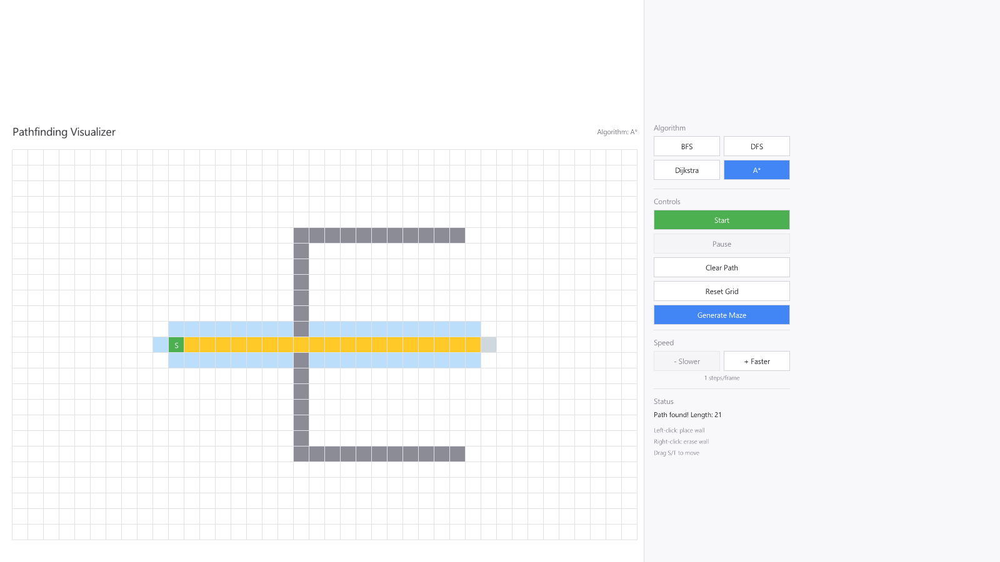
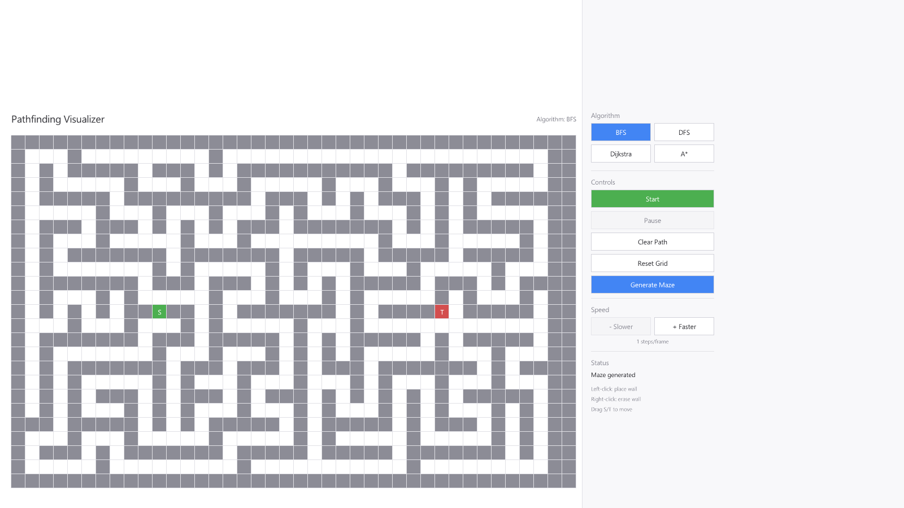
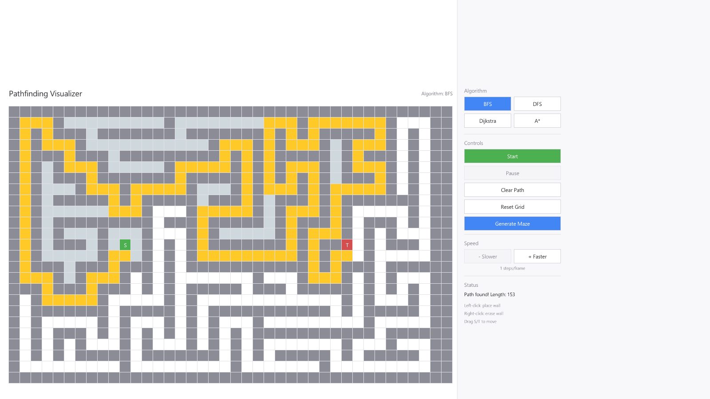
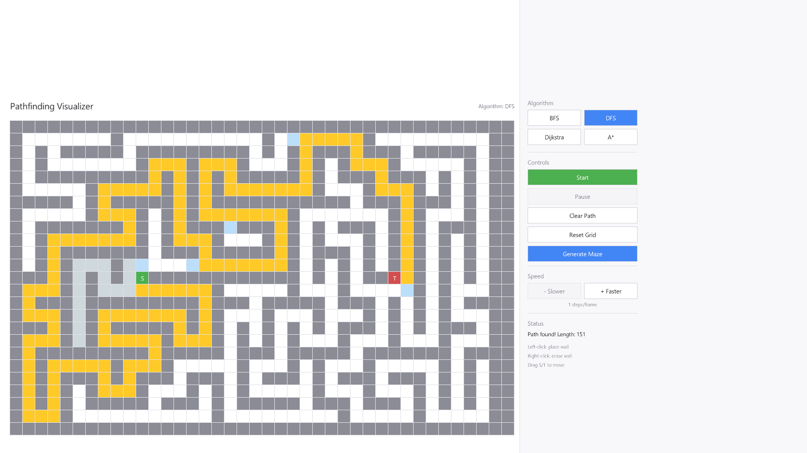

# Pathfinding Visualizer

An interactive 2D pathfinding and maze generation visualizer built in **C++17** and **Raylib**, featuring a **clean, minimal, modern white interface**. Watch classic graph search algorithms explore grid environments step-by-step, generate procedural mazes with guaranteed solvability, draw custom wall obstacles, drag start and target endpoints in real time, and compare algorithmic exploration patterns.


---

## Application Interface


*The clean, minimal white interface: interactive 25×40 grid (left) with real-time controls and status panel (right).*

---

## Overview

The **Pathfinding Visualizer** provides an intuitive, real-time visual representation of how fundamental graph search algorithms traverse 2D grid spaces. Designed with a clean architectural separation between graph logic and rendering, the core pathfinding algorithms run incrementally per frame without blocking the UI thread.

### Key Highlights

- **Real-Time Step-by-Step Visualization**: Configurable execution speeds (1 to 50 steps per frame) allow users to observe subtle differences in node expansion, queue ordering, and heuristic guidance.
- **Procedural Maze Generation**: Generates complex, organic-looking mazes using an iterative randomized Depth-First Search (recursive backtracker) algorithm, with guaranteed solvability between endpoints.
- **Interactive Wall Editing & Draggable Endpoints**: Click and drag walls, erase obstacles with right-click, or drag Start (`S`) and Target (`T`) nodes across the grid while the simulation adjusts.
- **Fully Decoupled Headless Core**: Algorithm and maze logic are isolated in `PathfindingCore`, enabling comprehensive headless unit tests without requiring a window or GPU context.

---

## Visual Demonstrations

### Complete Workflow Demonstration

The following demonstration shows procedural maze generation, algorithm selection, real-time search progression, and final path reconstruction:



---

### Algorithm Comparisons

#### 1. Heuristic Search vs. Exhaustive Search: A* vs. Dijkstra

When confronted with an obstacle wall, Dijkstra's algorithm expands radially in all directions, examining many nodes behind the starting position. In contrast, A* leverages the Manhattan distance heuristic to guide its search frontier directly toward the target, significantly reducing the number of explored nodes while still guaranteeing the shortest path.

| Dijkstra's Algorithm (Radial Exploration) | A* Search (Heuristic-Guided Search) |
| :---: | :---: |
|  |  |
| *Dijkstra explores uniformly outward; visits numerous nodes before bypassing the wall.* | *A\* focuses exploration forward toward the target, finding the same 21-step path.* |

---

#### 2. Maze Solving: Breadth-First Search (BFS) vs. Depth-First Search (DFS)

On procedural mazes, BFS explores every corridor level-by-level to ensure the optimal, shortest path. DFS dives as deep as possible into each passage before backtracking, producing a meandering, non-optimal path but demonstrating the nature of stack-based exploration.

| Procedural Maze Generation | Breadth-First Search (Optimal Path) | Depth-First Search (Exploratory Path) |
| :---: | :---: | :---: |
|  |  |  |
| *Randomized DFS maze with guaranteed path from Start (S) to Target (T).* | *BFS guarantees the shortest route (153 steps), exploring all branches evenly.* | *DFS finds a solution (151 steps) by wandering deep into corridors.* |

---

## Supported Algorithms

All algorithms operate on a 4-directional grid (North, South, East, West) with uniform step weights ($1.0$).

| Algorithm | Optimality | Data Structure | Time Complexity | Space Complexity | Description |
| :--- | :---: | :---: | :---: | :---: | :--- |
| **Breadth-First Search (BFS)** | **Optimal** | `std::queue` | $O(V + E)$ | $O(V)$ | Explores neighbors layer by layer. Guarantees the shortest path on unweighted grids. |
| **Depth-First Search (DFS)** | **Non-Optimal** | `std::stack` | $O(V + E)$ | $O(V)$ | Follows a branch as deep as possible before backtracking. Finds a valid path, but not the shortest. |
| **Dijkstra's Algorithm** | **Optimal** | `std::priority_queue` | $O((V + E) \log V)$ | $O(V)$ | Expands nodes in order of cumulative path cost $g(n)$. Guarantees shortest path and handles stale queue entries gracefully. |
| **A\* Search** | **Optimal** | `std::priority_queue` | $O((V + E) \log V)$ | $O(V)$ | Prioritizes nodes using $f(n) = g(n) + h(n)$, where $h(n)$ is the admissible Manhattan distance heuristic $ | x_1 - x_2 | + | y_1 - y_2 | $. Explores significantly fewer nodes than Dijkstra. |

---

## Features

- **Four Pathfinding Algorithms**: BFS, DFS, Dijkstra, and A* with polymorphic runtime swapping.
- **Procedural Maze Generator**: Iterative randomized Depth-First Search backtracker carving corridors with 100% path solvability guarantee.
- **Clean Minimal Design**:
  - High-contrast white background (`#FFFFFF`) and soft panel background (`#F8F8FA`).
  - Subtle grid borders and clean typography using system font integration (Segoe UI / Arial).
  - Clear visual states:
    - **Start Node (`S`)**: Muted green (`#4CAF50`)
    - **Target Node (`T`)**: Muted red (`#D34E4E`)
    - **Wall Obstacles**: Medium charcoal gray (`#8C8C96`)
    - **Frontier Nodes**: Pale sky blue (`#BBDEFB`)
    - **Visited Nodes**: Soft light blue-gray (`#CFD8DC`)
    - **Final Path**: Soft amber yellow (`#FFCA28`)
- **Simulation Controls**:
  - **Start / Pause / Resume**: Full lifecycle control over active visualizations.
  - **Clear Path**: Clears search history, visited nodes, and paths while preserving placed walls.
  - **Reset Grid**: Clears all walls and search data back to an empty grid.
  - **Generate Maze**: Replaces current walls with a fresh procedurally generated maze.
  - **Speed Adjustment**: Modify simulation pace from 1 step/frame up to 50 steps/frame.
- **Interactive Mouse Controls**:
  - Left-click or drag on empty cells to paint walls.
  - Right-click or drag on wall cells to erase walls.
  - Left-click and drag Start (`S`) or Target (`T`) cells to reposition endpoints.
- **Headless Unit Test Suite**: 43 test cases (657 assertions) powered by `doctest` to ensure correctness without GPU dependencies.

---

## Controls and Usage

| Action | Control | Description |
| :--- | :--- | :--- |
| **Draw Walls** | `Left-Click` (or drag) | Converts empty cells into solid wall obstacles. |
| **Erase Walls** | `Right-Click` (or drag) | Clears wall obstacles back to empty cells. |
| **Move Endpoints** | `Left-Click + Drag` on `S` / `T` | Repositions Start or Target node across the grid. |
| **Select Algorithm** | Click sidebar buttons | Chooses between **BFS**, **DFS**, **Dijkstra**, or **A\***. |
| **Start / Resume** | Click **Start** / **Resume** | Begins or resumes the incremental search visualization. |
| **Pause** | Click **Pause** | Halts simulation progress to inspect current frontier state. |
| **Clear Path** | Click **Clear Path** | Removes visited/path tiles while keeping existing walls intact. |
| **Reset Grid** | Click **Reset Grid** | Clears the entire board to default empty state. |
| **Generate Maze** | Click **Generate Maze** | Carves a new procedural maze across the grid. |
| **Adjust Speed** | Click **- Slower** / **+ Faster** | Changes simulation speed between 1 and 50 steps per frame. |
| **Exit** | `Escape` or Window Close | Closes the application. |

---

## Project Architecture

The codebase separates core pathfinding algorithms, grid data models, and procedural generation from rendering and UI logic:

```
Pathfinding-Visualizer/
├── include/
│   ├── Core/
│   │   └── Types.hpp            # Enums (NodeState, AlgorithmType, EngineState) & Position struct
│   ├── Grid/
│   │   ├── Node.hpp             # Node model (position, costs g/h/f, parent pointer, state)
│   │   └── GridModel.hpp        # Pure 2D grid matrix and bounds validation
│   ├── Algorithms/
│   │   ├── IPathfinder.hpp      # Polymorphic interface (initialize, step, isComplete, getPath)
│   │   ├── BFS.hpp              # Breadth-First Search implementation
│   │   ├── DFS.hpp              # Depth-First Search implementation
│   │   ├── Dijkstra.hpp         # Dijkstra's Algorithm implementation
│   │   └── AStar.hpp            # A* Search implementation with Manhattan heuristic
│   ├── Maze/
│   │   └── MazeGenerator.hpp    # Iterative randomized DFS recursive backtracker
│   ├── Engine/
│   │   └── VisualizerEngine.hpp # State machine orchestrating pathfinder execution & speed
│   ├── Rendering/
│   │   └── GridRenderer.hpp     # Raylib rendering for grid, cell borders, and labels
│   └── UI/
│       └── UIManager.hpp        # Raylib rendering for sidebar buttons, headers, and status
├── src/                         # Implementations corresponding to include/ headers
│   ├── Algorithms/
│   ├── Engine/
│   ├── Grid/
│   ├── Maze/
│   ├── Rendering/
│   ├── UI/
│   └── main.cpp                 # Application entry point, window lifecycle, and input loop
├── tests/
│   ├── doctest.h                # Header-only unit test framework (doctest v2.4.11)
│   └── test_algorithms.cpp      # 43 unit tests covering algorithms, edge cases, and mazes
├── docs/
│   └── images/                  # Verified application screenshots and GIF demonstrations
├── CMakeLists.txt               # Build configuration (FetchContent for Raylib 5.5)
└── README.md                    # Project documentation
```

### Key Design Patterns

1. **Strategy Pattern (`IPathfinder`)**: Uniform algorithm contract (`initialize()`, `step()`, `isComplete()`, `isPathFound()`, `getPath()`) enables dynamic swapping at runtime without reallocating grid structures.
2. **State Machine (`VisualizerEngine`)**: Coordinates transitions between `IDLE`, `RUNNING`, `PAUSED`, and `FINISHED`, safely handling user input and algorithm switching.
3. **Raylib Decoupling (`PathfindingCore`)**: The core static library compiles independently of Raylib, allowing headless unit tests to run fast and deterministically in continuous integration environments.

---

## Technology Stack

- **Language**: C++17 (standard library containers, algorithms, memory management)
- **Graphics & Input**: [Raylib 5.5](https://www.raylib.com/) (hardware-accelerated 2D rendering, modern windowing, input polling)
- **Build System**: [CMake 3.16+](https://cmake.org/) (cross-platform configuration using `FetchContent`)
- **Unit Testing**: [doctest v2.4.11](https://github.com/doctest/doctest) (lightweight, zero-dependency C++ test framework)

---

## Installation and Build Instructions

### 1. Clone the Repository

```bash
git clone https://github.com/esthermichelle/Pathfinding-Visualizer.git
cd Pathfinding-Visualizer
```

### 2. Configure and Build

#### Windows (MSYS2 / MinGW UCRT64)

```bash
# Configure with MinGW Makefiles
cmake -S . -B build -G "MinGW Makefiles" -DCMAKE_BUILD_TYPE=Release

# Build executable and test suite
cmake --build build --config Release
```

#### Windows (Visual Studio / MSVC)

```bash
# Configure for Visual Studio
cmake -S . -B build

# Build Release binary
cmake --build build --config Release
```

#### Linux (Ubuntu / Debian)

```bash
# Install dependencies for Raylib
sudo apt-get update
sudo apt-get install -y build-essential cmake git libasound2-dev libx11-dev \
    libxrandr-dev libxi-dev libgl1-mesa-dev libglu1-mesa-dev libxcursor-dev libxinerama-dev

# Configure and build
cmake -S . -B build -DCMAKE_BUILD_TYPE=Release
cmake --build build
```

#### macOS

```bash
# Configure and build
cmake -S . -B build -DCMAKE_BUILD_TYPE=Release
cmake --build build
```

---

## Running the Application

After building, launch the executable from the project root:

```bash
# Windows
./build/PathfindingVisualizer.exe

# Linux / macOS
./build/PathfindingVisualizer
```

### Command-Line Arguments

The executable supports built-in flags for automated captures and initial states:

- `--screenshot <path>`: Renders initial frames, exports a PNG screenshot of the window to `<path>`, and exits cleanly.
- `--maze`: Pre-generates a procedural maze upon startup.

```bash
# Example: Launch directly with a generated maze and export a screenshot
./build/PathfindingVisualizer.exe --maze --screenshot docs/images/maze-generation.png
```

---

## Running Tests

The test suite runs headlessly without opening any window or requiring GPU hardware:

```bash
# Run tests using CTest
ctest --test-dir build --output-on-failure

# Or execute the test binary directly for detailed doctest output
./build/PathfindingTests.exe
```
